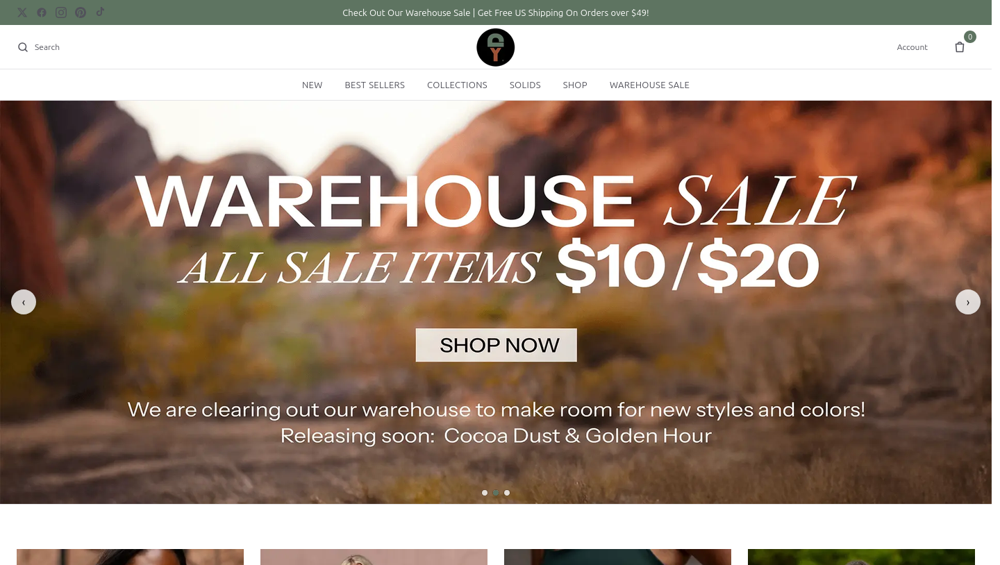
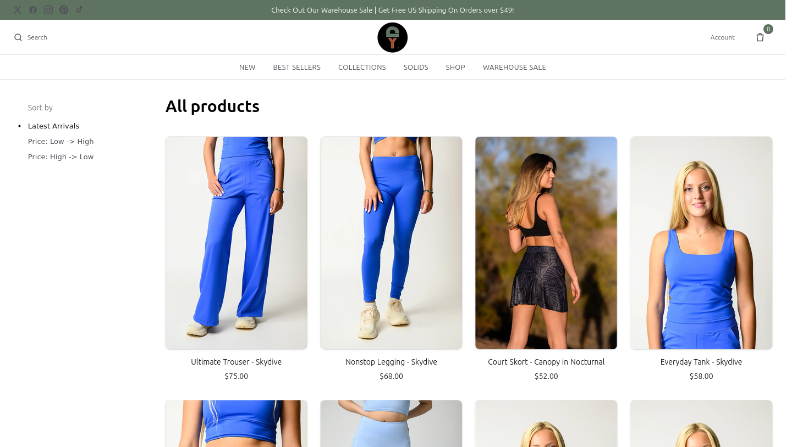
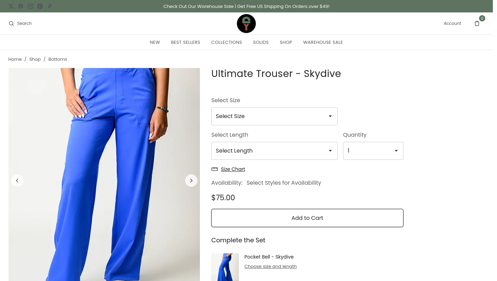
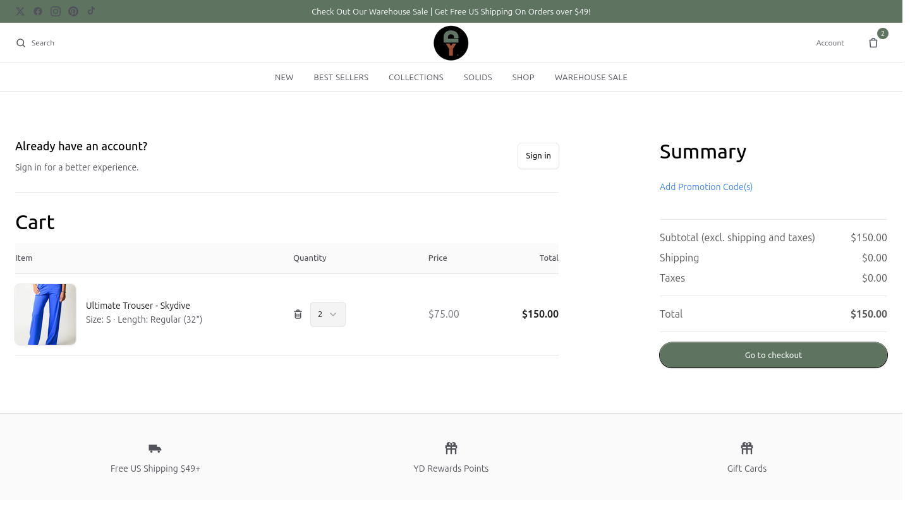
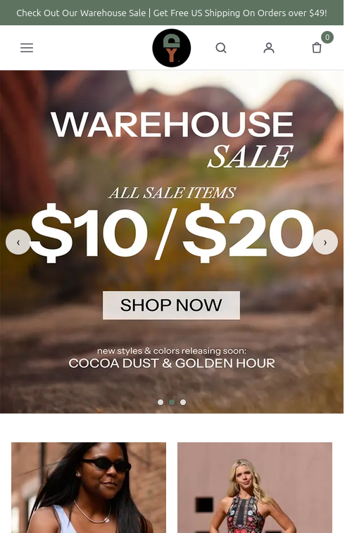

# Yoga Democracy — an apparel company run with Claude

I'm Jeff Cannon. I run **Yoga Democracy**, a yoga and activewear brand that owns its own
factory in Kenya, ships from US warehouses, and sells direct online. I'm not a software
engineer by training. Over 2026 I rebuilt how the business runs by directing a team of
**Claude agents** — and they built, among other things, the replacement online store in
this repository.

This repo is the public, cleaned-up showcase of that work: the store's code, how the agents
were organised, and real problems they solved in a working company. No customer data, keys or
credentials are included.



---

## The store

A full replacement for our Salesforce Commerce Cloud site, built on open-source
[Medusa v2](https://medusajs.com) (commerce backend) and Next.js (storefront).

| Shop | Product page |
|---|---|
|  |  |

| Cart | Mobile |
|---|---|
|  |  |

**What's in it**

- **557 products** imported from the live catalogue — copy, photos, sizes, inseam lengths,
  categories, sale prices — with parity checks against the old site.
- **Real business rules** that the off-the-shelf platform doesn't have: selling on backorder,
  "discontinued = sell while stock lasts, never backorder", sale prices as a separate price list
  so a sale can end without losing the regular price.
- **Two payment integrations written from scratch** — CyberSource (cards, Google Pay) and PayPal —
  with sandbox test harnesses that walk the real checkout in a headless browser.
  (`payments/`)
- **Transactional email** — order confirmation, shipping notices, password reset, abandoned
  cart, gift certificates — with tests that check no other customer's data can leak into an
  email. (`backend/apps/backend/src/modules/email`)
- **Order history from the old platform**, read-only, so a customer sees the same past orders
  whether they sign in or look up a guest order. (`backend/.../lib/legacy-orders.ts`)
- **Reviews** (Yotpo) and SEO redirects carried over from the old site.

Status: the store runs as a private preview. The launch was paused in October 2026 to focus the
team on fulfilment — a business decision, not a technical one.

---

## How it was built: a team of agents

Instead of one long chat, I ran **Claude Code** as a set of named agents on a DGX Spark in my
office, each with one job, its own working copy of the code, and a written brief. I talk to
them from my phone (Remote Control / Slack / Telegram).

| Agent | Owns |
|---|---|
| `yd-store` | storefront, navigation, the URL map from the old site |
| `yd-pdp` | product pages — sizes, lengths, availability, reviews |
| `yd-cat` | catalogue import and parity with the old site |
| `yd-pay` | payments — CyberSource and PayPal providers |
| `yd-email` | transactional email |
| `yd-accounts` | customer accounts and order history |
| `yd-ops` | reviews the others' work; release checks |
| `tally` | inventory and order truth across warehouses (in production) |
| `cs` | customer-service triage in Zendesk (in production) |

A few things I learned running agents this way — see [docs/how-i-work-with-agents.md](docs/how-i-work-with-agents.md):

- **One owner per area.** Two agents editing the same files is how outages happen.
- **Every hard-won lesson goes in the brief.** e.g. *"the publishable key must map to exactly one
  sales channel"* broke the site three times before it became a rule with an automated guard.
- **Proof, not reports.** An agent saying "fixed" doesn't count; a test, a screenshot, or a number
  that matches the source system does.
- **Humans press send.** Agents draft customer emails and purchase orders; a person approves them.

---

## AI in the real business

The store is the visible part. Most of the value has been operational. Short write-ups, with
real numbers and no customer details:

1. **[Why did a customer's order miss an item that was in stock?](docs/case-studies/01-order-delay.md)**
   Joined ~2,300 orders across ShipStation and the warehouse system and found every evening order
   waits ~12 hours to reach the warehouse — so a later order can take the last unit.
   

2. **[Product photos for a new colour without a photoshoot](docs/case-studies/02-skydive-recolour.md)**
   Recoloured existing shoots into our new "Skydive" blue, colour-matched to real product photos.
   

3. **[80 fabric swatches cut automatically from factory print files](docs/case-studies/03-print-swatches.md)**
   

4. **[Inventory and customer-service agents in daily use](docs/case-studies/04-tally-and-cs.md)** —
   what we own, what we owe, and a drafted answer for every "where is my order?" ticket.

5. **[Reviewing API access before it went live](docs/case-studies/05-security-review.md)** —
   catching an over-broad permission that would have let an integration start any job on the
   production store.

---

## Running it locally

```bash
# backend (Medusa v2, Postgres)
cd backend && npm install
cp apps/backend/.env.template apps/backend/.env   # fill in your own values
npx medusa db:migrate && npm run dev

# storefront (Next.js)
cd storefront && yarn
cp .env.template .env.local                       # point at your backend + publishable key
yarn dev
```

Product data and images are not included in this repository.

---

*Built by directing Claude (Anthropic) — Claude Code for the engineering, Claude in Slack and
Telegram for day-to-day operations.*
