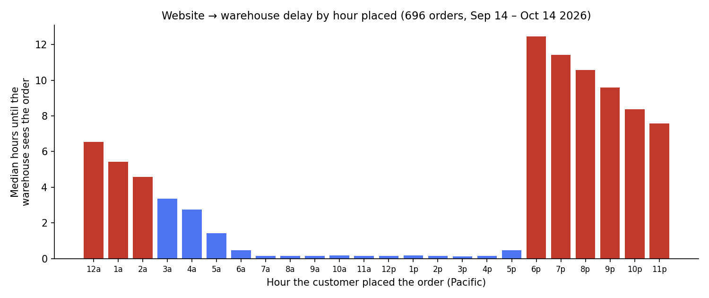

# Why did a customer's order miss an item that was in stock?

**The question.** A customer ordered a pair of capri leggings on a Monday evening. The website
showed it in stock. Two days later her order was split and the leggings were marked "On Order" —
the warehouse had shipped its last unit to someone else.

**First answer (wrong).** Our inventory agent compared order dates and concluded orders take
two days to reach the warehouse. Plausible, and it would have sent us chasing the wrong fix.

**What we actually did.** I asked Claude to measure the gap across *every* recent order, not
just the one complaint:

- pulled ~2,300 orders from ShipStation (when the customer placed it, when ShipStation got it)
- pulled the same orders from the warehouse system, Infoplus (when the warehouse got it)
- matched them by order number, corrected for the three systems' different time zones,
  and excluded orders bulk-loaded during a warehouse move

**What it found.** 696 website orders over one month:

- During the day an order reaches the warehouse in **about 10 minutes**.
- **Every order placed after ~5:30 pm Pacific waits until ~7 am the next morning** — 8 to 12
  hours. The delay is between the website and ShipStation; ShipStation → warehouse takes seconds.
- In the case that started this, the customer ordered at 6:01 pm, another customer ordered the
  same item at 8:12 pm, **both arrived at the warehouse two minutes apart at 7 am** — and the
  warehouse shipped the *later* order the same day.

**Why it matters.** It wasn't overselling and it wasn't a two-day lag. It was two specific,
fixable things — an overnight pause in the order import, and the warehouse not picking
oldest-first — and we went to our developer and warehouse with numbers instead of a hunch.

**How long it took.** About 20 minutes, read-only against production systems.
