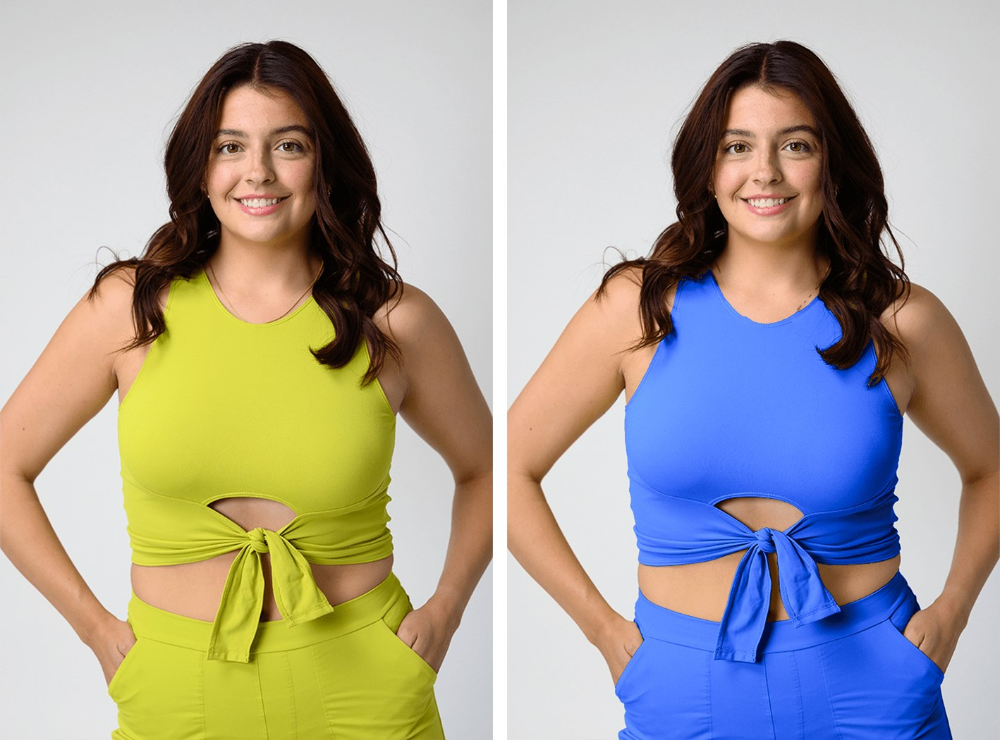
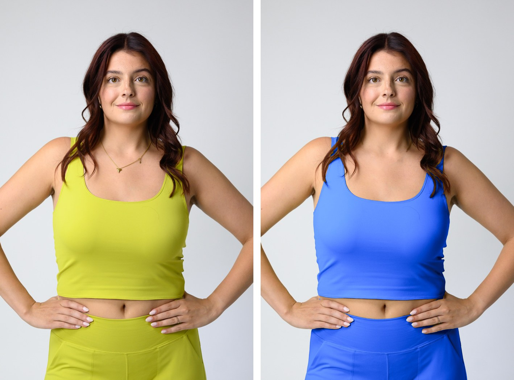
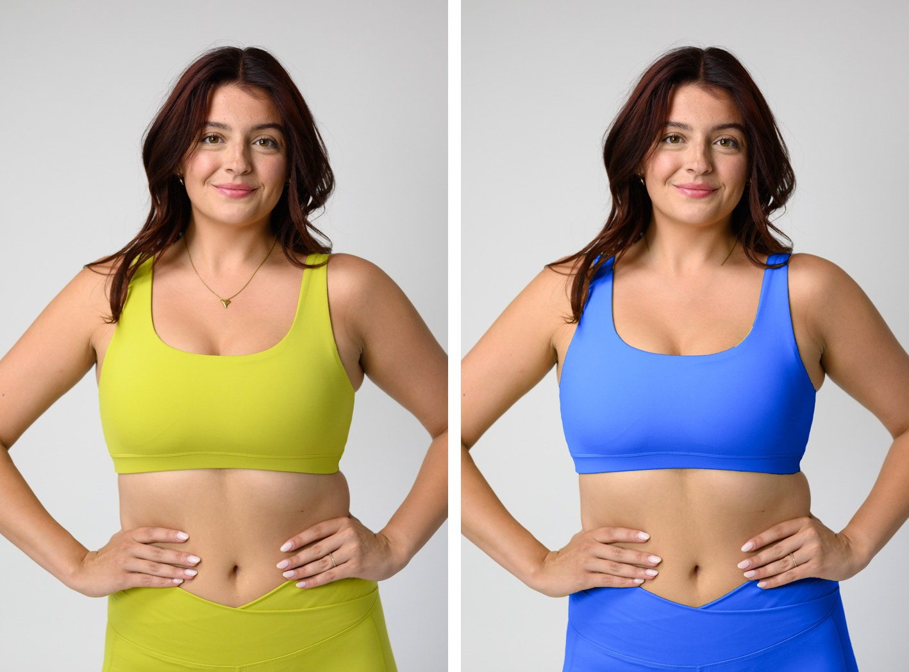

# Product photos for a new colour without a photoshoot

**The problem.** We launched a new solid colour, *Skydive* blue, and had ~100 units of three
styles in stock with no photos — so they couldn't be listed.

**What Claude did.** Recoloured existing studio shots of the same styles (photographed in
lime "Spring Grove") into Skydive, in Python, no Photoshop:

- **Learned the target colour from real photos** — sampled every Skydive pixel in our existing
  Skydive product shots and fitted how the blue shifts from shadow to highlight, so folds and
  seams keep their depth instead of looking painted.
- **Separated garment from skin by colour science, not guesswork.** In the Lab colour space,
  skin never measured above a 77° hue angle and the lime fabric never below 92°, even in deep
  shadow — so the edit can't paint skin, however dark.
- **Kept shoes and floor clean** by ignoring weak reflected colour (bounce light from the lime
  fabric onto white sneakers).
- **Removed jewellery** that lay across the fabric, so it didn't turn blue with the top.

| Original (Spring Grove) → Skydive | |
|---|---|
|  |  |

**Honest part.** The first versions bled blue onto skin and sneakers, and turned a gold necklace
blue. It took several rounds of feedback — and a rule that every version is checked zoomed-in on
hands, shoes, jewellery and straps before it's sent. The final set went to our photographer as a
brief, and is good enough to list while real photos are scheduled.

**Result.** 12 listing-ready images across three styles, plus a PDF brief for the photographer.
