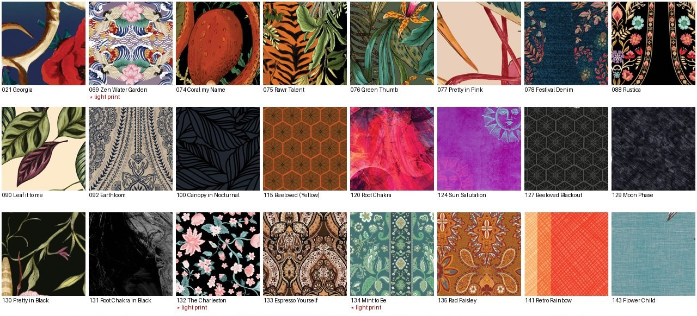

# 80 fabric swatches cut automatically from factory print files

**The problem.** We're building a "design your own" page: pick a style, pick one of our prints,
see it. That needs a clean square of each print's fabric. What we had were the factory's
sublimation layouts — 30–75 MB images of flat pattern pieces with white gaps between them.

**What Claude did.** For each of 82 prints:

1. found the smallest layout file for that print across four style folders on Google Drive
2. shrank it, built a "fabric" mask (anything not near-white), and eroded it so seams,
   notches and printed labels drop out
3. took the largest leg panel and cut the biggest clean square from the thigh area,
   rejecting any square with more than 1% white
4. named it from the print library sheet and uploaded it, never overwriting an existing file

**Result.** 80 of 82 prints in one run (~3.5 GB of source files). The two failures —
designs that are mostly white by nature — were flagged for a person rather than forced.
A contact sheet and a CSV with every source file went into the shared folder for review.
